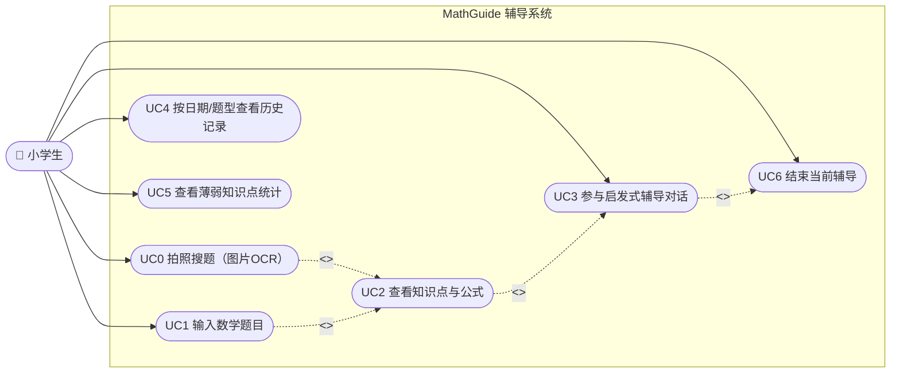
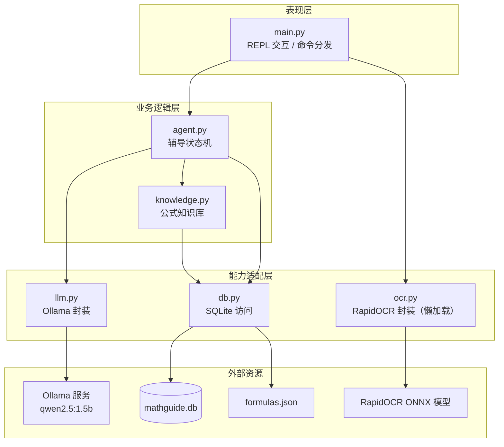
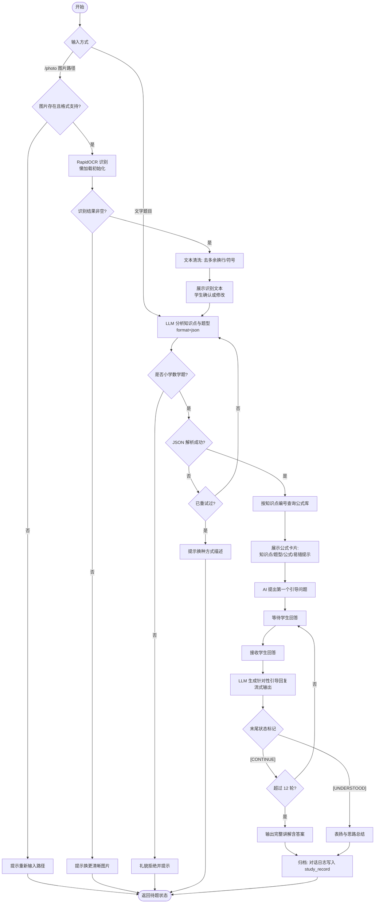
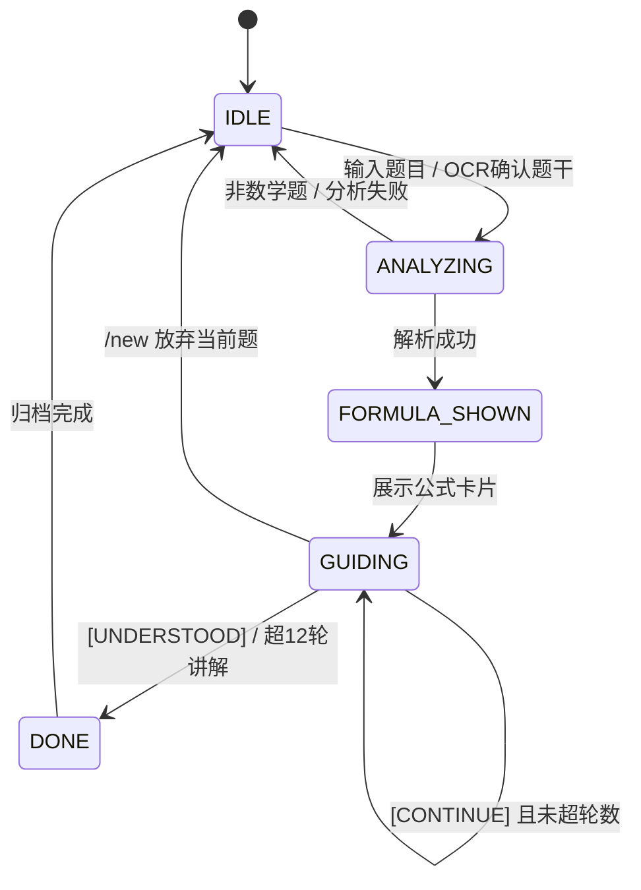
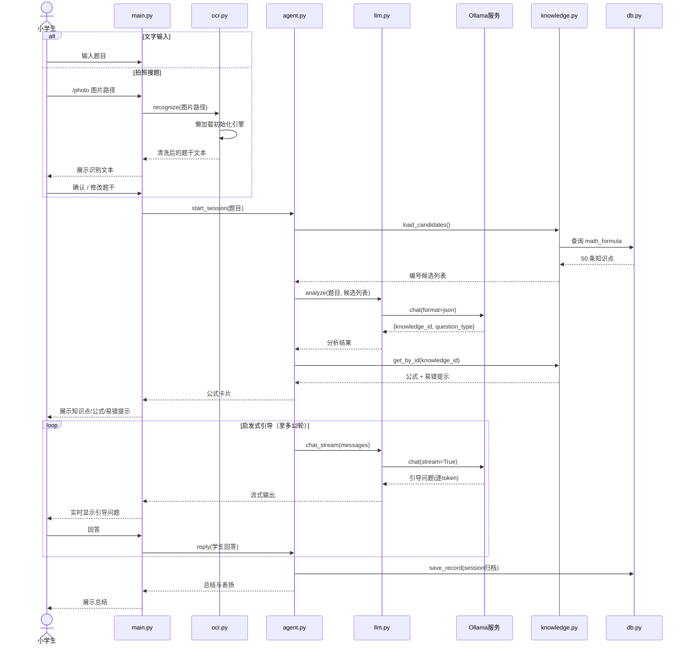
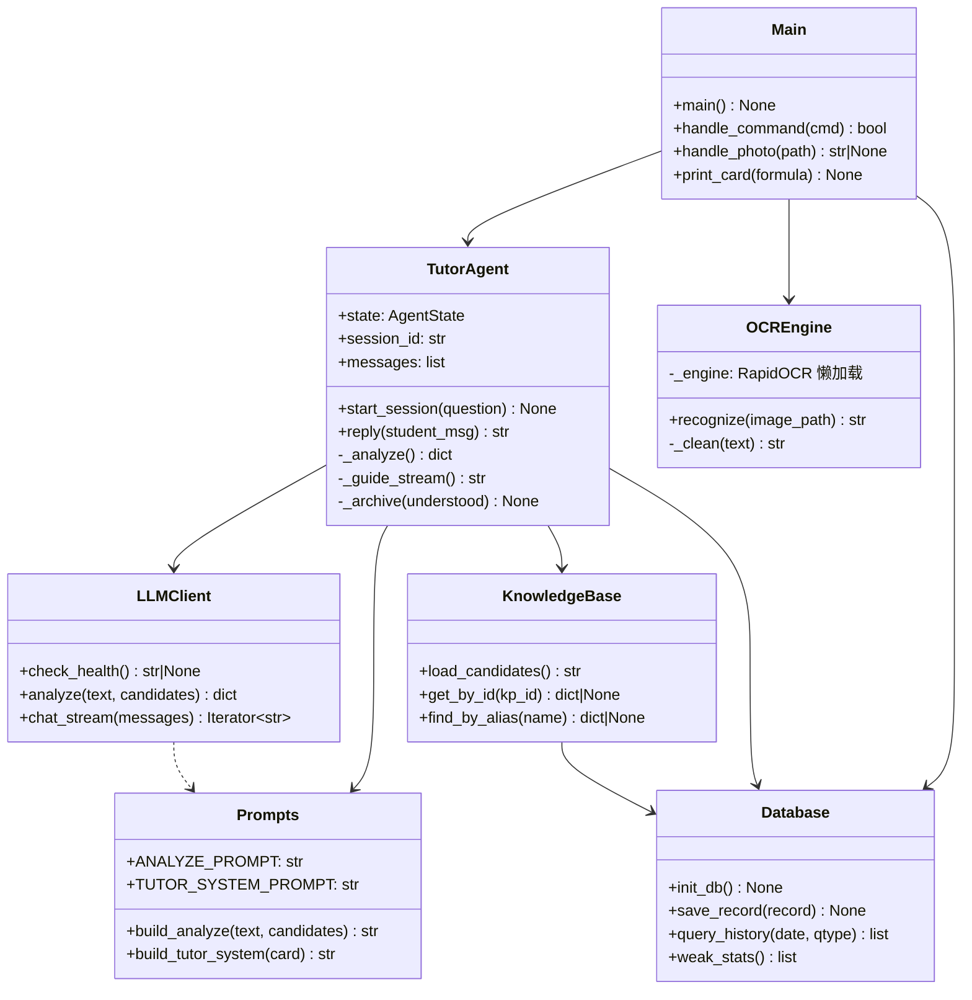
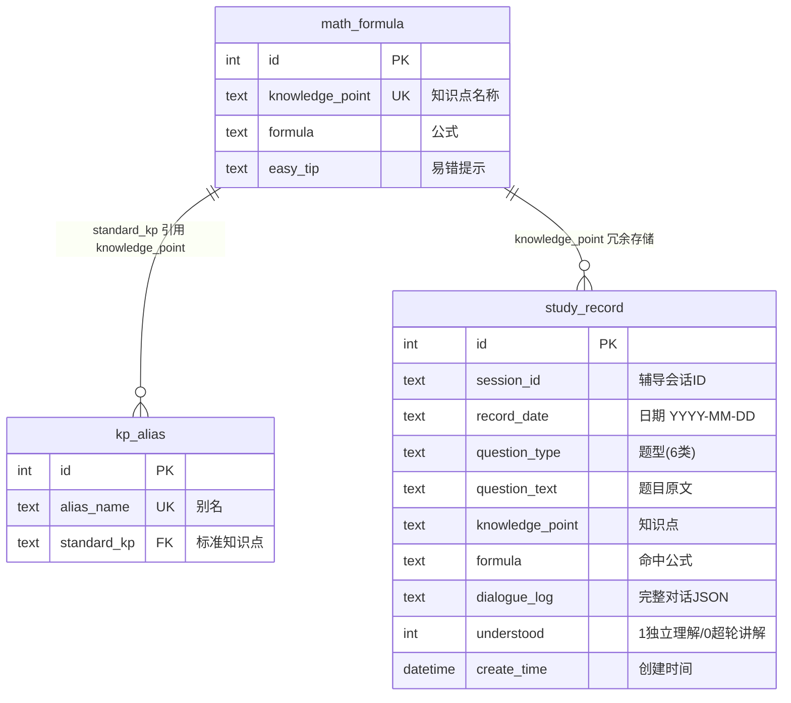

# MathGuide：小学数学启发式辅导 Agent — 软件工程设计文档

- 日期：2026-10-08（v2：加入 RapidOCR 拍照搜题）
- 状态：待用户审查
- 课程：软件工程（本文档按"需求分析 → 概要设计 → 详细设计"组织，UML 图使用 Mermaid 绘制，可直接渲染）
- 上游依据：项目根目录 [README.md](../../../README.md) 中的完整毕设方案，本文档为其**精简版 Agent** 的落地设计

## 1. 项目概述

### 1.1 目标

制作一个在本地终端运行的简单 Agent：本地部署小参数大模型，针对**小学数学**进行启发式辅导与问答，帮助小学生学习数学。

区别于直接给答案的搜题软件，本 Agent 采用**苏格拉底式启发教学**：展示公式 → 逐步提问 → 引导学生自己推导出答案。

### 1.2 范围（与 README 完整方案的关系）

| README 完整方案 | 本精简版 |
|---|---|
| Vue3 + Vite 前端 | 不含，终端 REPL 交互 |
| FastAPI 后端 | 不含，纯 Python 进程 |
| PaddleOCR 拍照搜题 | **保留**——改用 RapidOCR 轻量方案（同款模型 ONNX 移植），`/photo 图片路径` 触发 |
| 本地大模型启发式辅导 | **保留（核心）** |
| SQLite 公式知识库（防幻觉） | **保留** |
| 错题记录（按日期/题型归档） | **保留** |
| 变式题生成 | 不含（后续可扩展） |

### 1.3 运行环境约束

- Windows 11，Python 3.12.10（已确认）
- 物理内存 16GB，但用户反馈可用内存紧张 → **模型选小参数版；OCR 模块懒加载，不用时不占内存**
- Ollama 尚未安装 → 部署文档需包含安装步骤

## 2. 需求分析

### 2.1 参与者（Actor）

| 参与者 | 说明 |
|---|---|
| 小学生（学生） | 系统唯一用户，输入/拍摄错题、参与启发式对话、查看历史与统计 |

### 2.2 用例图



### 2.3 用例描述

| 用例 | 简要说明 | 前置条件 | 基本流 | 异常流 |
|---|---|---|---|---|
| UC0 拍照搜题 | 学生提供题目图片路径，系统 OCR 识别为文字并可人工修正 | 系统处于 IDLE | 1. 输入 `/photo 图片路径` 2. 系统 OCR 识别并展示文本 3. 学生确认或修改 4. 进入 UC2 | E1: 图片不存在/格式不支持 → 提示重新输入；E2: 识别结果为空 → 提示换更清晰图片；E3: OCR 引擎初始化失败 → 提示并降级为文字输入 |
| UC1 输入数学题目 | 学生打字输入一道小学数学题 | 系统处于 IDLE | 1. 输入题目 2. 系统分析知识点与题型 3. 进入 UC2 | E1: 非小学数学内容 → 礼貌拒绝；E2: 分析失败 → 重试 1 次后提示换种说法 |
| UC2 查看知识点与公式 | 系统展示该题的知识点、题型、公式、易错提示 | UC0/UC1 得到题干 | 1. 系统按知识点编号查库 2. 展示公式卡片 | E1: 未匹配到知识点 → 跳过公式卡片直接辅导 |
| UC3 参与启发式辅导对话 | 学生与 AI 老师多轮对话，逐步被推导出答案 | UC2 完成 | 1. AI 提出引导问题 2. 学生回答 3. AI 针对性追问 4. 学生独立解出 → 表扬总结、归档 | E1: 超 12 轮未理解 → 系统给出完整讲解后归档 |
| UC4 查看历史记录 | 按日期或题型筛选过往辅导记录，可回看完整对话 | 存在历史记录 | 1. 输入 `/history [日期\|题型]` 2. 系统列出匹配记录 3. 选中查看详情 | E1: 无匹配记录 → 提示为空 |
| UC5 查看薄弱知识点统计 | 按知识点统计未独立理解的次数并排序展示 | 存在历史记录 | 1. 输入 `/stats` 2. 展示排序清单 | E1: 无记录 → 提示为空 |
| UC6 结束当前辅导 | 辅导中途放弃当前题目 | 处于辅导中 | 1. 输入 `/new` 2. 丢弃当前会话回 IDLE | — |

### 2.4 非功能需求

| 类别 | 需求 |
|---|---|
| 性能 | 低内存环境可运行：LLM + 进程常驻 ≤ 4GB；OCR 引擎懒加载，使用后单个进程内总占用 ≤ 5GB；流式输出首 token ≤ 5s（1.5b 模型 CPU 推理） |
| 隐私 | 全离线运行（OCR 与大模型均本地），题目、图片与对话不出本机 |
| 可靠性 | LLM 服务不可达时友好提示而非崩溃；公式不经模型生成，杜绝公式幻觉；OCR 失败可降级为手动输入 |
| 易用性 | 命令不超过 7 个，无参数也能用；引导语言符合小学生认知；OCR 结果必须经学生确认再使用 |
| 可维护性 | 模块职责单一，提示词与代码分离，模型名可配置，OCR 与辅导流程解耦 |

## 3. 概要设计

### 3.1 技术选型

| 组件 | 选型 | 理由 |
|---|---|---|
| 模型运行时 | Ollama | Windows 一键安装；`ollama pull` 一条命令拉模型；自带 HTTP 服务 |
| 大模型 | `qwen2.5:1.5b`（默认） | 约 1GB 内存占用，低内存环境可跑；小学数学封闭域够用 |
| | `qwen2.5:3b`（可选升级） | 效果更好，配置常量一行切换 |
| LLM 调用 | `ollama` 官方 Python SDK | 依赖最少；支持流式输出与 `format=json` 结构化输出 |
| OCR | `rapidocr_onnxruntime` | 与 PaddleOCR 同款识别模型的 ONNX 移植版；脱离 Paddle 框架，依赖小、内存低、离线；懒加载 |
| 知识库/记录存储 | SQLite（标准库 `sqlite3`） | 零配置、单文件 |
| 交互界面 | 终端 REPL | 最简，聚焦 Agent 核心逻辑 |
| 不使用 Agent 框架 | 无 LangChain 等 | 1.5b 小模型 function-calling 不稳定；提示词需要完全自控；场景封闭，自研状态机更稳 |

### 3.2 系统架构图（分层视图）



### 3.3 模块职责一览

| 模块 | 职责 | 依赖 |
|---|---|---|
| main.py | 程序入口、REPL 循环、命令解析分发、OCR 确认交互 | agent, db, llm, ocr |
| agent.py | 辅导状态机：分析→公式→引导→归档 | llm, knowledge, db, prompts |
| llm.py | Ollama 健康检查、JSON 分析、流式对话 | ollama SDK, config |
| ocr.py | RapidOCR 懒加载封装：图片识别、文本清洗 | rapidocr_onnxruntime |
| knowledge.py | 候选编号列表构建、按 id 查公式、别名兜底 | db |
| db.py | 建表、公式导入、记录写入、历史/统计查询 | sqlite3, config |
| prompts.py | 分析提示词与辅导系统提示词（与代码分离，便于调优） | 无 |
| config.py | 模型名、路径、轮数上限等常量 | 无 |

## 4. 详细设计

### 4.1 核心业务流程（活动图）

覆盖 UC0/UC1→UC2→UC3 的完整主流程：



### 4.2 辅导状态机（状态图）

agent.py 内部状态流转：



状态说明：

| 状态 | 含义 | 进入动作 |
|---|---|---|
| IDLE | 等待输入题目或 /photo | 显示提示符 |
| ANALYZING | LLM 分析题目中 | 生成 session_id |
| FORMULA_SHOWN | 公式卡片已展示 | 组装辅导 messages（系统提示词+题目+公式） |
| GUIDING | 启发式多轮对话中 | 每轮追加对话、解析状态标记 |
| DONE | 本轮辅导结束 | 写库归档 |

注：OCR 识别与确认在 main.py 层完成（不进入状态机），确认后的题干以与打字输入相同的方式进入 `ANALYZING`——OCR 与辅导流程解耦。

### 4.3 一次完整辅导的模块交互（时序图，含拍照搜题分支）



### 4.4 类图（模块结构）

本系统各模块以函数集合组织，以下以类图表达模块接口与关系：



### 4.5 OCR 模块设计（ocr.py）

| 设计点 | 方案 |
|---|---|
| 引擎 | `RapidOCR`（rapidocr_onnxruntime），首次使用时才实例化（懒加载），避免不常用功能常驻内存 |
| 输入校验 | 文件存在性、扩展名白名单（.jpg/.jpeg/.png/.bmp） |
| 文本清洗 | 合并识别行、去多余空行/首尾空白、保留数学符号（×÷=.%） |
| 结果确认 | 识别文本展示给学生：`直接回车确认 / 重新输入修正文本`——确认后的文本与打字输入走同一入口，**OCR 与状态机完全解耦** |
| 异常 | 文件不存在/格式不支持 → `OCRError`；识别结果为空 → 返回空串由 main 提示重拍；引擎初始化失败 → 提示并建议改用文字输入 |

### 4.6 数据库设计（ER 图）



DDL：

```sql
CREATE TABLE IF NOT EXISTS math_formula (
    id INTEGER PRIMARY KEY AUTOINCREMENT,
    knowledge_point TEXT UNIQUE,
    formula TEXT,
    easy_tip TEXT
);

CREATE TABLE IF NOT EXISTS kp_alias (
    id INTEGER PRIMARY KEY AUTOINCREMENT,
    alias_name TEXT UNIQUE,
    standard_kp TEXT,
    FOREIGN KEY (standard_kp) REFERENCES math_formula(knowledge_point)
);

CREATE TABLE IF NOT EXISTS study_record (
    id INTEGER PRIMARY KEY AUTOINCREMENT,
    session_id TEXT,
    record_date TEXT,          -- YYYY-MM-DD
    question_type TEXT,
    question_text TEXT,
    knowledge_point TEXT,
    formula TEXT,
    dialogue_log TEXT,         -- JSON 数组：[{"role":"student"|"teacher","content":"..."}]
    understood INTEGER,        -- 1 独立理解 / 0 超轮数讲解
    create_time TIMESTAMP DEFAULT CURRENT_TIMESTAMP
);
```

db.py 对外函数：`init_db()`（建表 + formulas.json 空库导入，幂等）、`save_record(...)`、`query_history(date=None, qtype=None)`、`weak_stats()`（按知识点统计 `understood=0` 次数降序）。

### 4.7 提示词设计（prompts.py）

**分析提示词（analyze）**：给模型题干 + 编号候选列表，要求输出 JSON：

```json
{
  "is_elementary_math": true,
  "knowledge_id": 7,
  "question_type": "几何应用题"
}
```

约束：非小学数学内容（作文、英语、初中题、闲聊）→ `is_elementary_math: false`；`question_type` 限定枚举：计算题 / 几何应用题 / 行程应用题 / 百分数应用题 / 单位换算题 / 平均数应用题。

**辅导系统提示词（chat）**，核心规则：
1. 角色：耐心、鼓励的小学生数学老师，语言口语化、符合小学生认知
2. 铁律：**严禁直接说出最终答案或完整算式结果**；每次只问**一个**引导性小问题
3. 已知信息注入：题干、公式、易错提示（模型据此提问，但不许照抄答案）
4. 学生答错 → 温和肯定思路中正确的部分，再换一个更小的提示问题
5. 输出约定：每轮回复正文之后，另起一行输出状态标记，二选一：
   - `[CONTINUE]`：还需继续引导
   - `[UNDERSTOOD]`：学生已独立推导出正确答案，本轮辅导结束

程序解析标记后**不将标记行展示给学生**。

### 4.8 关键算法/策略

**知识点防不匹配策略**（核心防幻觉设计）：把"让模型编名称"改为"让模型选编号"，从源头消除知识点匹配失败。

- `load_candidates() -> str`：构建编号列表注入分析提示词：
  ```
  1. 长方形面积 | 2. 正方形面积 | 3. 圆的面积 | ... | 50. 平均数
  ```
- 模型只返回 `knowledge_id`，程序 `get_by_id(kp_id)` 查表，公式零幻觉
- 兜底：id 无效时 `find_by_alias()` 走别名表（精确查 → LIKE 包含查）

**JSON 稳定性保障**：分析调用使用 Ollama 的 `format="json"` 模式，在解码层约束输出为合法 JSON——1.5b 小模型自由生成 JSON 易格式崩坏，这是关键保障。

### 4.9 界面设计（终端 REPL）

启动横幅 + 提示符交互，示例：

```
==================================================
  MathGuide 小学数学启发式辅导 (模型: qwen2.5:1.5b)
  直接输入题目开始辅导；拍题用 /photo 图片路径
  /help 查看全部命令
==================================================
题目> /photo D:\错题\IMG_001.jpg

【OCR 识别结果】
一个长方形花园长12米宽8米，面积是多少？
（直接回车确认，或重新输入修正后的题目）
确认> ⏎

【知识点】长方形面积  【题型】几何应用题
【公式】长方形面积 = 长 × 宽
【易错提示】注意区分周长和面积，周长用加法，面积用乘法

AI老师> 这道题要求长方形的什么呢？我们先回忆一下，面积表示什么呀？
你> 面积表示大小
AI老师> 说得对！那我们有了长和宽，应该怎么把它们变成面积呢？
你> 12乘8
AI老师> 太棒了！那 12×8 等于多少呢？
你> 96
AI老师> 完全正确！你自己算出来啦，长方形花园的面积是 96 平方米。
        记得带上单位"平方米"哦！
✔ 本轮辅导已保存
题目>
```

命令一览：

| 命令 | 作用 |
|---|---|
| `/photo 图片路径` | OCR 拍照搜题，识别后确认/修正进入辅导 |
| `/history` | 列出全部历史记录（日期 + 题型 + 题目摘要） |
| `/history 2026-10-08` | 按日期筛选 |
| `/history 几何应用题` | 按题型筛选 |
| `/stats` | 薄弱知识点统计（按未理解次数排序） |
| `/new` | 辅导中放弃当前题目，回到 IDLE |
| `/help` | 命令帮助 |
| `/quit` | 退出 |

### 4.10 配置（config.py）

```python
MODEL_NAME = "qwen2.5:1.5b"   # 可改 "qwen2.5:3b"
DB_PATH = "data/mathguide.db"
FORMULAS_JSON = "data/formulas.json"
MAX_GUIDE_ROUNDS = 12          # 单题最大引导轮数，防止无限对话
ANALYZE_RETRY = 1              # JSON 解析失败重试次数
OCR_IMAGE_EXTS = {".jpg", ".jpeg", ".png", ".bmp"}  # OCR 支持的图片格式
```

### 4.11 目录结构

```
MathGuide/
├── main.py            # 入口：REPL 循环、命令分发、OCR 确认交互
├── agent.py           # 辅导状态机
├── llm.py             # Ollama 封装
├── ocr.py             # RapidOCR 封装（懒加载 + 文本清洗）
├── knowledge.py       # 公式知识库
├── db.py              # SQLite 访问
├── prompts.py         # 全部提示词
├── config.py          # 配置常量
├── data/
│   └── formulas.json  # 50 条小学数学公式初始数据（含别名）
├── tests/
│   ├── test_knowledge.py
│   ├── test_db.py
│   ├── test_agent.py  # mock LLM 的状态机测试
│   └── test_ocr.py    # mock RapidOCR 引擎
├── requirements.txt   # ollama、rapidocr_onnxruntime（+ 测试用 pytest）
└── README.md          # 部署与使用说明
```

## 5. 错误处理

| 场景 | 处理 |
|---|---|
| Ollama 未安装/未启动 | 启动时健康检查，打印安装与启动指引后退出 |
| 模型未拉取 | 提示 `ollama pull qwen2.5:1.5b` 后退出 |
| 图片路径不存在/格式不支持 | 提示重新输入，不进入辅导流程 |
| OCR 识别结果为空 | 提示"未识别到文字，请换更清晰的印刷体题目照片" |
| OCR 引擎初始化失败 | 打印原因并提示可改用直接打字输入，程序不退出 |
| 分析 JSON 解析失败 | 自动重试 1 次；再失败提示"没看懂题目，请换种方式描述"回 IDLE |
| 模型返回无效 knowledge_id | 别名表兜底匹配；仍失败按"未匹配知识点"处理：跳过公式展示直接引导 |
| 输入为非数学内容 | `is_elementary_math=false` → 礼貌拒绝并提示仅支持小学数学题 |
| 引导超过 12 轮未理解 | 输出完整讲解（含答案）后归档，标记 `understood=0` |
| LLM 调用异常 | 统一 `LLMError`，main 层捕获打印友好提示，不崩溃退出 |

## 6. 测试策略

### 6.1 单元测试（pytest，LLM 与 OCR 引擎全部 mock）

- `test_knowledge.py`：候选列表构建、按 id 查询、别名精确/模糊兜底
- `test_db.py`：建表幂等、公式导入幂等、记录写入、按日期/题型查询、薄弱统计排序
- `test_agent.py`：mock `llm.analyze` / `llm.chat_stream`，覆盖状态机流转——正常全流程、非数学拒绝、JSON 重试、超轮数兜底讲解、标记解析
- `test_ocr.py`：mock RapidOCR 引擎——路径校验、扩展名白名单、文本清洗（合并行/去空行/保留数学符号）、空识别结果处理

### 6.2 手动测试用例清单（真机联调）

6 类题型各至少 1 道真题，验证：知识点选对、公式正确、全程不泄答案、标记正常结束。另加 2 条 OCR 用例。示例：

| 题型 | 题目 | 预期 |
|---|---|---|
| 计算题 | 25×44 用简便方法计算 | 匹配乘法运算律，引导拆 44=4×11 |
| 几何应用题 | 一个长方形花园长12米宽8米，面积是多少？ | 匹配长方形面积，全程不直接给 96 |
| 行程应用题 | 甲乙两地相距300千米，汽车每小时行60千米，几小时到达？ | 匹配路程公式 |
| 百分数应用题 | 一件商品原价200元，打八折后多少钱？ | 匹配折扣/百分数 |
| 单位换算题 | 3.5千米等于多少米？ | 匹配长度单位换算 |
| 平均数应用题 | 小明三次数学成绩92、88、96，平均分是多少？ | 匹配平均数 |
| 负例 | "帮我写一篇作文" | 拒绝辅导 |
| OCR 正例 | 印刷体试卷题目照片 | 正确识别并进入辅导 |
| OCR 负例 | 手写潦草照片 | 识别差 → 学生可修正后继续使用 |

## 7. 部署步骤（写入 README）

1. 安装 Ollama（Windows 安装包）
2. `ollama pull qwen2.5:1.5b`
3. `pip install -r requirements.txt`（`ollama`、`rapidocr_onnxruntime`；开发另需 `pytest`）
4. `python main.py`

首次使用 OCR 时 RapidOCR 会自动下载 ONNX 模型文件（约 10-20MB，一次性）。

## 8. 风险与局限（如实记录）

1. 1.5b 小模型引导话术存在幻觉风险 → 公式由知识库查表兜底；提示词强约束；超轮数兜底讲解
2. 模型算术可能出错 → 提示词要求模型不硬算多步计算，侧重思路引导
3. OCR 对手写体识别效果有限，仅推荐印刷体题目（前端确认环节兜底）；图片中几何图形无法解析，仅识别文字
4. 启发质量依赖提示词调优，需用手动用例多轮验证

## 9. 后续可扩展方向（本期不实现）

- 变式题生成、掌握标记、Markdown 错题导出、ECharts 统计
- FastAPI + Vue3 前后端分离（演进到 README 完整方案，届时可换 PaddleOCR 并支持摄像头直拍）
